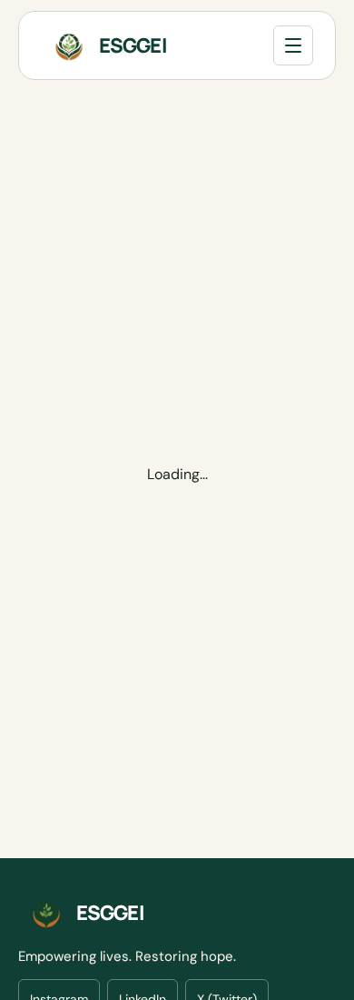
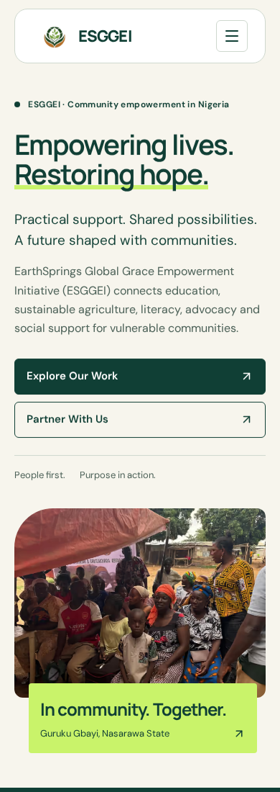

# ESGGEI brand-search audit — 16 November 2026

Repository: `Usiju-Peter/ESGGEI2026`. Audited main: `ac19833d748d1b0492427135c78c54201e922bbe` (PR #7). Fix branch: `seo/brand-search-20261116`. Public site: https://www.esggei.org.ng/.

## Conclusion and limits

There is a confirmed static-rendering defect, alongside inconsistent brand metadata. The homepage, gallery and article contain their main content in hidden React streaming segments; without JavaScript, the homepage displays “Loading…”. Finding an H1 somewhere in raw HTML had concealed this problem in earlier checks. This branch fixes the rendering defect and strengthens the connection between ESGGEI, its full name and its canonical website.

These findings do **not** prove why Google positions the site differently for “ESGGEI” and longer queries. Google can render JavaScript; a rendering dependency is not proof of deindexing. No authenticated Search Console property was available through the reporting connector (`workspaces: []`), and no shared-browser inspection tool was available for an existing signed-in session. Google's selected canonical, indexed rendering, query positions, penalties and sitemap-submission status remain unverified. Generic web-search results are not a controlled Google Nigeria ranking measurement.

The original checkout was clean and preserved. A separate worktree was created from freshly fetched main. React, Vite, existing URLs, content, forms and design are retained. No production deployment, account edits, indexing requests, sitemap submissions or outreach messages were performed.

## Findings by severity

| Priority | Confirmed evidence | Resolution/status |
| --- | --- | --- |
| P1 | Live HTML for `/`, `/gallery` and `/blog/from-purpose-to-action` contains pending boundary templates and hidden `S:0` segments. A real browser with JavaScript disabled shows the homepage loading fallback. | Fixed build-time prerendering: prevent React from outlining large, resolved Suspense boundaries. All ten pages now have a visible H1 inside `main` with JavaScript disabled. Browser and build checks guard this behavior. |
| P2 | Homepage title ends in `(ESGGEI)`; the preferred WebSite/NGO names are the full name. `og:site_name` is absent. This conflicts with the requested preferred short brand, although it is not invalid schema. | Exact requested homepage title and description; preferred schema names and Open Graph site name are now ESGGEI. Full organisation name remains `alternateName`. |
| P2 | Live homepage description changes after hydration, and its initial Open Graph description differs again. Internal page source titles/descriptions and hook values also differ. | One typed metadata registry now supplies Vite's generated head and the React hook. Ten unique title/description pairs are checked for exact source/hydration parity. |
| P2, external | Search Console indexing/canonical/query evidence is unavailable in this environment. | Exact owner steps below. This is an evidence gap, not proof that the owner's setup failed. |
| P2, external | A genuine NAN report names ESGGEI but its retrieved HTML contains no `esggei.org.ng` mention or backlink. | A possible relevant editorial website citation; no backlink was fabricated or requested. |
| P2, follow-up | A mobile lab measurement initially recorded LCP 2.73 seconds, above the 2.5-second ambition. | Reported honestly; isolated comparison is recorded in the QA evidence. This SEO change does not establish field CWV. |
| P3 | Older SEO documents refer to eight routes and superseded release status. | The historical audit now points to this ten-route audit; README release/maintenance guidance is updated. |

No confirmed P0 issue was found. Header/footer logo images previously had empty alt text inside explicitly named brand links. That can be valid accessibility markup; it was not an established accessibility failure. Both now have the requested descriptive `ESGGEI logo` alt text while the link name remains `ESGGEI home`.

## Live technical checks before changes

The [HTTP evidence](evidence/2026-11-16-live-http.json) records 21 public requests. These are actual HTTP checks, not local test-server results.

| Check | Observed result |
| --- | --- |
| All ten public routes | HTTP 200, unique source titles/descriptions, correct production canonical; no observed HTML/header `noindex`. Content is present in raw HTML, with the three streaming exceptions described above. |
| Homepage | HTTP 200; one H1 exists in the response but is outside the visible `main` until a React reveal script runs. |
| `robots.txt` | HTTP 200; allows crawling and declares the production sitemap. |
| `sitemap.xml` | HTTP 200; ten distinct canonical URLs matching the route registry. |
| `http://www.esggei.org.ng/` | One redirect to HTTPS www. |
| `https://esggei.org.ng/` | One redirect to HTTPS www. |
| `http://esggei.org.ng/` | Two redirects to HTTPS www. Consolidation already works; the extra hop is a minor possible future optimization, not a confirmed ranking blocker. |
| `/index.html`, `/about/index.html` | Redirect to `/` and `/about`, respectively. |
| `/about/` | HTTP 200 with `/about` as canonical. An accessible alias with a matching canonical is not automatically an indexing error. |
| Homepage with `utm_source` | HTTP 200; canonical omits the query string. |
| Two nonexistent URLs, including a nonexistent blog slug | Actual HTTP 404, not a homepage served with status 200. |

Existing verification meta/file assets are preserved. A public verification token does not prove ownership verification is complete in the Google account. No robots/sitemap or production redirect changes were necessary based on these observations.

Both Vercel configuration files still contain a legacy catch-all route. Actual live unknown URLs returned 404 despite that source configuration. Do not claim that production has a soft-404 problem from configuration alone. Recheck real deployment statuses after future hosting/routing changes; local Express fixtures cannot certify Vercel routing.

## Implementation

- Homepage title: `ESGGEI | EarthSprings Global Grace Empowerment Initiative`.
- Homepage description: `Discover ESGGEI (EarthSprings Global Grace Empowerment Initiative), a Nigerian nonprofit organisation committed to empowerment, sustainable development and positive community impact.`
- Visible hero introduction now connects the full name and `(ESGGEI)`; its existing Nigeria/community kicker leads with ESGGEI. The meaningful mission H1 and original composition remain.
- One organisation identity has types `Organization` and `NGO`; NGO is already an Organization subtype. This makes the requested explicit type available without creating a duplicate entity.
- Both organisation and WebSite use `name: ESGGEI`, the full name as `alternateName`, the existing canonical URL and stable IDs. Existing logo, contact details, social URLs, breadcrumbs and article data are retained. Existing social destinations are not newly authenticated account-ownership claims.
- `og:site_name` is ESGGEI on all ten pages. Other page descriptions retain the existing factual source wording; article titles add the ESGGEI suffix. Social image/type values now agree before and after hydration.
- React's default progressive size threshold caused larger completed boundaries to be emitted as hidden chunks. `progressiveChunkSize` is disabled for the build-time static render, which still waits for `onAllReady`. No runtime streaming server, framework migration, DOM rewriting, new dependency or asset deletion is introduced.

JSON-LD is parsed and asserted in real browsers: one graph, one explicit organisation identity, one WebSite, expected names/URLs/logo/socials and the route-specific WebPage ID. This is structural/content validation, not a claim that Google has accepted the preferred site name. Google's Rich Results Test does not validate the site-name feature.

## Changed files

| Files | Purpose |
| --- | --- |
| `src/lib/siteMetadata.ts` (new), `src/lib/seo.ts`, `vite.config.ts` | Shared metadata for initial HTML and client navigation. |
| `src/lib/structuredData.ts` | Preferred short brand, full alternate name, explicit Organization/NGO identity. |
| `index.html` | Exact requested homepage fallback title/description and sharing metadata. |
| `src/pages/{Home,About,Projects,Outreach,Gallery,Blog,BlogArticle,Team,Partner,Privacy}.tsx` | Canonical-route metadata hook calls; natural homepage brand mentions. |
| `src/components/{Navbar,Footer}.tsx` | Logo alt text, retaining existing accessible home links and social destinations. |
| `scripts/prerender-entry.tsx`, `scripts/prerender.mjs`, `scripts/seo-check-built.mjs` | Inline static content and assertions against hidden streaming output. |
| `scripts/site-quality.mjs` | Support the organisation's multiple schema types. |
| `scripts/brand-seo-check.mjs` (new), `package.json`, `.github/workflows/seo.yml` | Repeatable JavaScript-off/on metadata/content checks and CI coverage. |
| `README.md`, `docs/seo/SEO-AUDIT.md`, this report and `docs/seo/evidence/2026-11-16-*` | Current maintenance guidance and retained audit evidence. |

## Verification performed

Node 24.22.1, TypeScript, Playwright Chromium and Lighthouse 13.6.0 were used locally. Final source checks, TypeScript and the production build passed.

| Check | Result |
| --- | --- |
| `npm run lint` | Passed. |
| `npm run seo:check` | Passed; sitemap current, ten source entrypoints. |
| `npm run build` | Passed; all ten pages prerendered with no hidden streaming segments. Existing empty motion-chunk warning remains nonblocking. |
| `npm run seo:check-built` | Passed; H1 within `main`, correct canonicals, completed static boundaries. |
| `node scripts/site-quality.mjs` | Passed: ten route schemas, 256 internal links/fragment targets, 101 local asset references. |
| `npm run seo:check-brand` | Passed: visible H1s without JavaScript on ten pages, unique metadata, exact hydration parity, schema checks, actual client navigation, no observed runtime/hydration errors. |
| Homepage responsive captures | Eight full-page screenshots at 320, 375, 390, 430, 768, 1024, 1440 and 1920 pixels; no horizontal overflow. Reviewed full-page 320/1440 captures, the eight-width hero contact sheet and the 390-pixel JavaScript-disabled homepage. |
| JavaScript-disabled captures | Homepage, gallery and article at 390 pixels. All three are now readable without the React reveal script. |
| `node scripts/browser-smoke.mjs` | Passed ten hydrated routes, client navigation/schema updates, mobile menu/Escape/focus, mocked contact success/failure, FAQ keyboard behavior and gallery keyboard/focus behavior. No real enquiry was sent. |
| `node scripts/accessibility.mjs` | Passed 20 scans: ten routes at 390/1440 pixels, zero detected A/AA violations. There are 22 incomplete scan findings requiring human judgment. Biography dialog keyboard/focus checks also passed. This is not full WCAG certification or a screen-reader audit. |
| `node scripts/analytics-check.mjs` | Passed mocked consent, withdrawal, reacceptance and URL-query redaction. Does not verify a real GA4 property or event delivery. |

The initial new browser test failed on the real homepage streaming defect. After the fix, all ten JavaScript-disabled pages passed. A later test-harness attempt to click hidden desktop navigation at mobile width was corrected to use a desktop viewport; the final navigation check passed.

Before/after browser captures, each cropped to the first 1,100 pixels of a 390-pixel-wide page:

Raw repeatable test artifacts are generated in ignored `audit-results/brand-seo/` and `audit-results/accessibility.json`. CI uploads `audit-results`. Committed public HTTP/browser snapshots and [QA summary](evidence/2026-11-16-qa-summary.json) retain the audit baseline. A build passing does not certify production until the approved deployment is tested.

### Mobile performance measurement

The baseline uses the preserved local build whose source matches audited main. The final after run was isolated from the other browser suites. Both use gzip-compressed loopback delivery, Lighthouse 13.6.0, simulated mobile networking and 4× CPU slowdown; these are not measurements of the public CDN or Nigerian visitors.

| Local homepage run | Performance | Accessibility / Best practices / SEO | LCP | CLS | TBT |
| --- | --- | --- | --- | --- | --- |
| Before | 97 | 100 / 100 / 100 | 2.511 s | 0 | 36 ms |
| After, isolated | 97 | 100 / 100 / 100 | 2.573 s | 0 | 38 ms |

The initial after run overlapped other browser checks and recorded performance 96, LCP 2.731 s and TBT 71.5 ms. That prompted an isolated rerun, rather than an optimization claim from a noisy comparison. Single runs cannot establish a performance trend; neither isolated LCP result meets 2.5 seconds. Additional measured image/font/rendering optimization remains worthwhile. No field p75 LCP/CLS/INP was obtained, and TBT is not INP.

## Remaining Search Console actions

Use the existing Google account and the correct domain property `esggei.org.ng`, or the URL-prefix property `https://www.esggei.org.ng/`. No passwords, screenshots or recovery codes need to be sent to the developer.

1. In **URL Inspection**, inspect exactly `https://www.esggei.org.ng/`. Record whether it is indexed, its last crawl, page-fetch result, crawl/indexing permissions, user-declared canonical and Google-selected canonical. The requested preferred URL is HTTPS www.
2. Open **View crawled page** when available. Inspect the indexed HTML and rendered view. After deployment, use **Test live URL** to compare against the corrected page. A successful live test is not proof that Google's stored indexed copy has updated.
3. If the selected canonical differs or the page is excluded, record the specific reason before changing anything. The reason may require a different remedy; do not infer a penalty or canonical problem from rankings alone.
4. In **Sitemaps**, inspect the existing `https://www.esggei.org.ng/sitemap.xml` submission: status, last read and discovered pages. Submit it only if absent or genuinely invalid; public availability is already verified.
5. After an approved deployment passes live checks, request homepage indexing once if appropriate. Inspect the gallery/article if affected. Repeated unchanged submissions do not guarantee faster ranking.
6. In **Performance → Search results**, choose Web and the last 28 days. Filter queries for ESGGEI, ESGGEI Nigeria, ESGGEI NGO and the full name; use a query regex such as `(?i)esggei|earthsprings` for a broader branded view. Compare all countries with Nigeria, then mobile and desktop. Record impressions, clicks, CTR and average position; use the homepage page filter to investigate the desired destination. Low-volume/anonymised queries may be omitted, and reporting is delayed.
7. Check **Manual actions** and **Security issues**. No such problem was established in this audit. Review **Core Web Vitals** if enough field data exists; unavailable data is not a pass or failure.

GA4 is useful for understanding visitors and consent-based performance telemetry. It is not a prerequisite for Google indexing, an indexing submission mechanism or a ranking boost. No new Measurement ID was provided or fabricated. With little traffic, field CWV may remain unavailable even after correct instrumentation.

## Legitimate authority and publishing follow-up

The [News Agency of Nigeria report](https://nannews.ng/ngo-targets-food-security-community-safety-through-agriculture-healthcare-outreach/) names the organisation and reports on its outreach. Its retrieved HTML contains zero official-domain mentions; do not count it as an existing backlink. If appropriate and factually helpful to readers, an authorised representative could ask the publisher to cite the organisation's official website. No outreach was sent, and an editorial link remains the publisher's choice.

- Confirm that existing Instagram, LinkedIn and X profiles consistently show `ESGGEI`, its full name, accurate Nigeria/location context and the official website. Only account owners should edit them.
- Seek accurate listings in relevant, reputable NGO directories for which the organisation actually qualifies. Verify registration and contact facts before submission; no paid link networks, fake office listings or invented accreditations.
- Ask genuine partners to identify actual collaborations and link to relevant reports where useful. Do not imply partnerships absent documentary evidence or authorization.
- Publish one strong article weekly, or two only when evidence and editorial capacity support it. Prioritise documented ESGGEI projects and original, relevant expertise; use truthful bylines/dates and link to the About, programme and outreach pages naturally. Topic volume alone does not guarantee branded rankings.
- Retain organisational history and original reports. Add approved governance/registration/reporting information only when real records are supplied. No invented impact numbers, testimonials, policy commitments or affiliations.
- Use GSC queries and impressions to decide later content changes. Do not add repetitions of ESGGEI throughout every heading or publish broad unrelated articles to chase traffic.

## Follow-up after an approved deployment

Day zero is the actual production release date, not this audit date. This branch has not been deployed.

| When | Check and decision |
| --- | --- |
| D+0 | Verify public HTML has the exact title/description, visible content without JavaScript, correct schema/canonicals, healthy sitemap/robots and real 404s. Then inspect/test the homepage in GSC. Record the release date. |
| D+7 | Check whether the homepage has been recrawled since release and whether the indexed copy/canonical has changed. Record branded impressions/clicks/CTR/position with country/device filters; leave low-volume or missing data explicitly unavailable. |
| D+14 | Compare equivalent periods cautiously; review query variants, desired landing page and canonical exclusions. Check real citations/profile consistency and any verified new article. Avoid changing titles repeatedly before evidence accumulates. |
| D+30 | Review 28-day brand trends and genuine enquiries; inspect indexed page coverage, publication quality and earned citations. Review CWV p75 only with sufficient actual samples. Choose the next technical/content change from observed gaps. |

Google chooses ranking, titles and site names. Updates require recrawling and processing; the date and first organic position cannot be guaranteed.

## Primary guidance

- [Google site names](https://developers.google.com/search/docs/appearance/site-names): a concise preferred name, WebSite markup and consistent homepage signals help Google understand the intended name.
- [Organization structured data](https://developers.google.com/search/docs/appearance/structured-data/organization): organisation identity and legitimate profile references help disambiguation.
- [JavaScript SEO basics](https://developers.google.com/search/docs/crawling-indexing/javascript/javascript-seo-basics): check rendered content, canonicals and status behavior rather than assuming an SPA cannot be indexed.
- [Google title links](https://developers.google.com/search/docs/appearance/title-link) and [Search Essentials](https://developers.google.com/search/docs/essentials): descriptive titles and useful original content support discoverability without guaranteeing positions.
